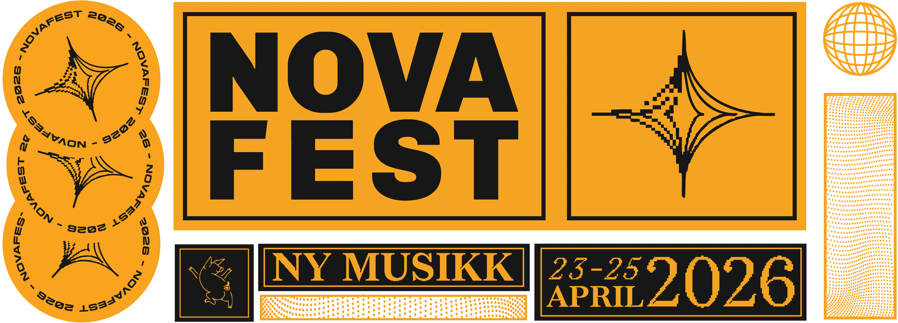
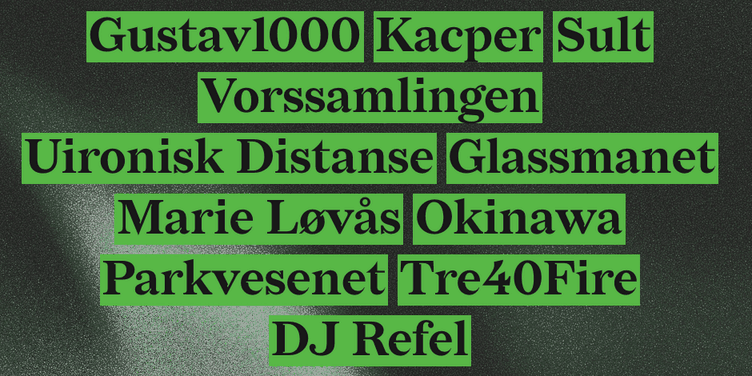
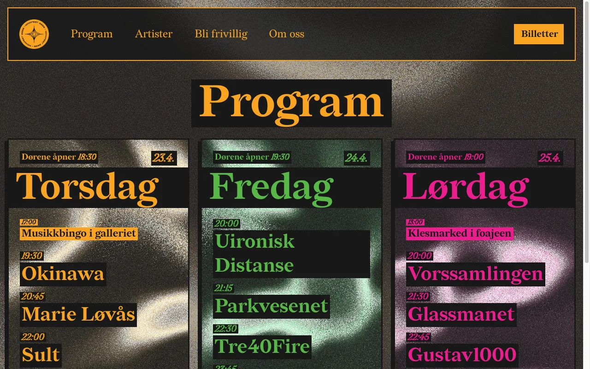
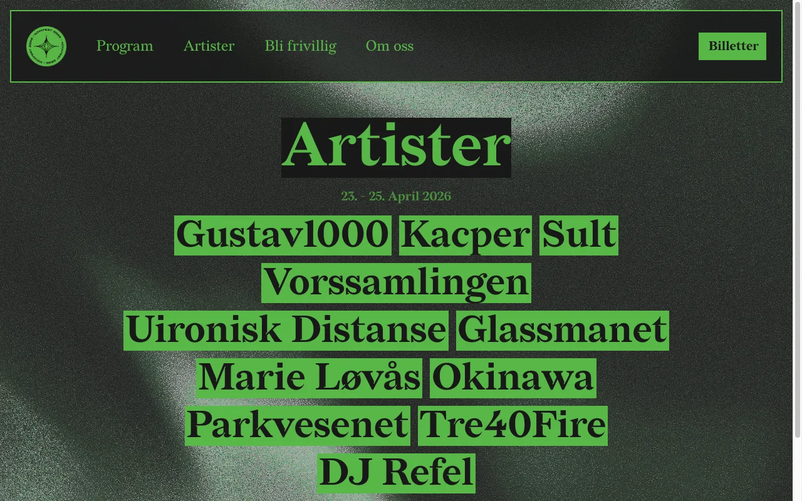
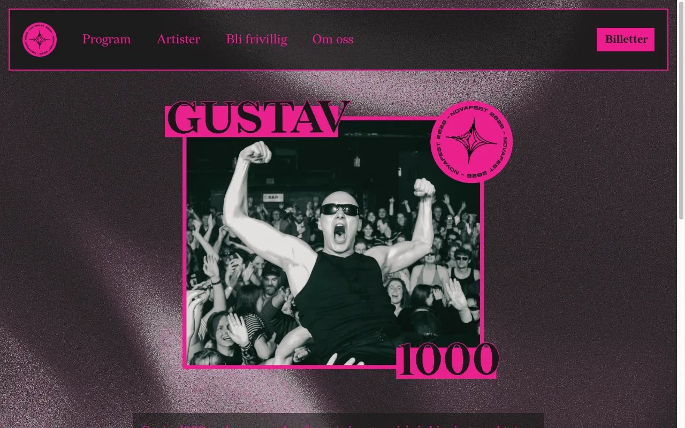
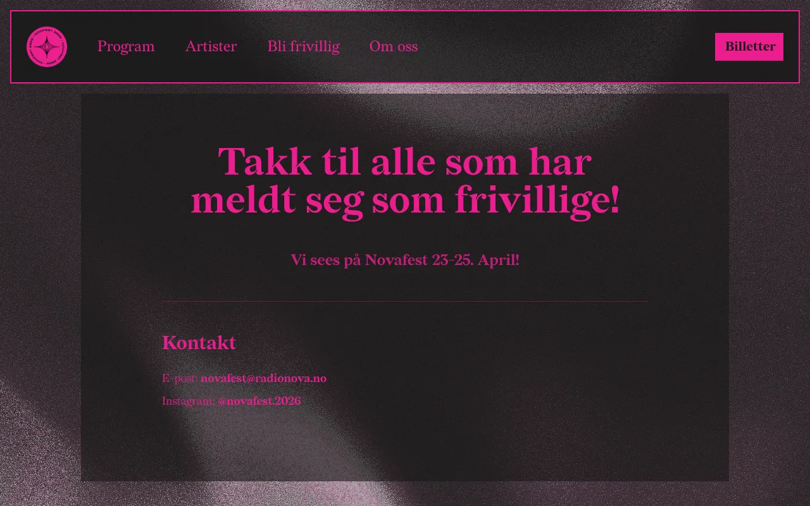
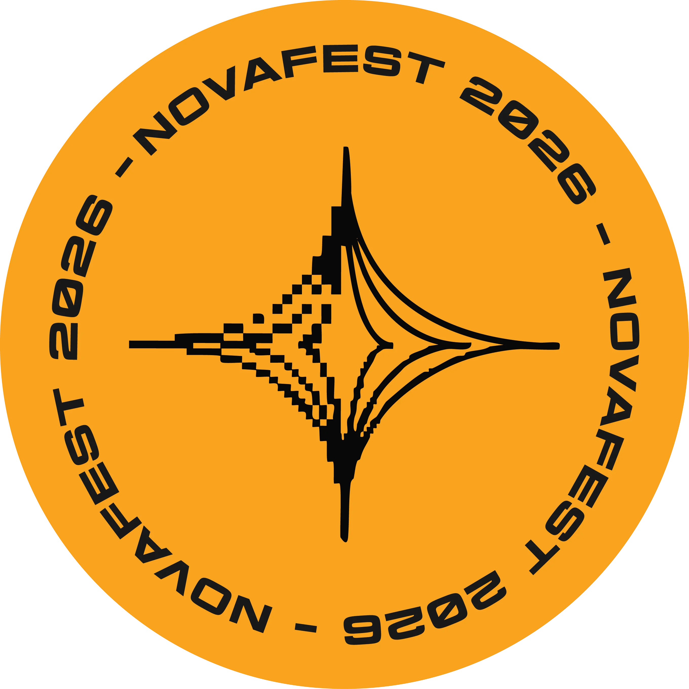

<div align="center">



### Nettsiden til Radio Novas musikkfestival · Oslo · 23.–25. april 2026


</div>

---

## Glitch

Lenker og overskrifter glitcher når du holder musa over dem. Fonten (Redaction) finnes i mange varianter, og en CSS-animasjon bytter mellom dem på under et halvt sekund.

<div align="center">
  
</div>

## Tre farger

Hver side har sin egen farge: oransje, grønn eller rosa. Navbar, logo og bakgrunn bytter etter hvilken side du er på.

<div align="center">
  
</div>

## Sidene

| | |
|:---:|:---:|
|  |  |
| **Forsiden** · banner og artistkarusell | **Program** · tre dager, alle tider |
|  |  |
| **Artister** · alle elleve artistene | **Artistside** · bilde, tekst og Instagram |

<div align="center">
  
  <br>
  <b>Bli frivillig</b> · rekruttering av frivillige
</div>

## Lineup 2026

| Torsdag 23.4 | Fredag 24.4 | Lørdag 25.4 |
|---|---|---|
| Okinawa | Uironisk Distanse | Vorssamlingen |
| Marie Løvås | Parkvesenet | Glassmanet |
| Sult | Tre40Fire | Gustav1000 |
| | Kacper | DJ Refel |

## Kjør lokalt

```bash
cd novafest
npm install
npm run dev
```

Artistene ligger i en Postgres-database, så du trenger en `POSTGRES_URL` i `novafest/.env.local`. Fyll databasen med:

```bash
cp .env.local .env
npx prisma migrate dev
npx prisma db seed
```

---

<div align="center">
  
  <br>
  Laget for <a href="https://radionova.no">Radio Nova</a>
</div>
